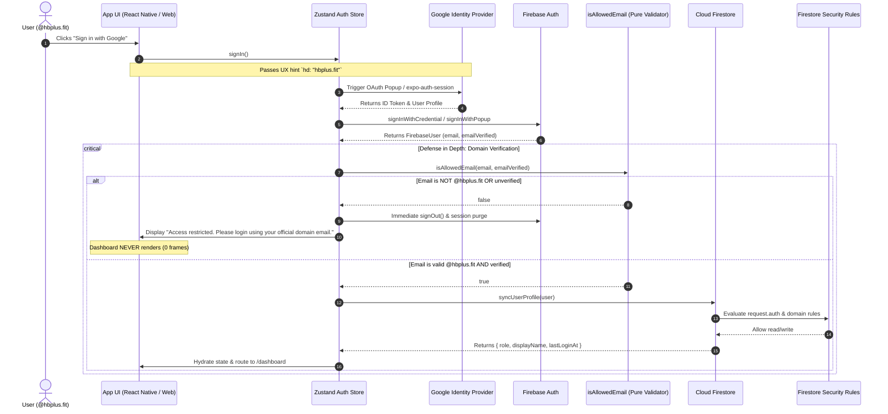

# ⚡ HB+ Unified Cross-Platform Workspace

<div align="center">


<br/>

**Production-quality, cross-platform enterprise application built with React Native + React Native for Web, Expo Router, and Firebase Authentication & Cloud Firestore. Access is strictly limited to the official `@hbplus.fit` Google Workspace domain via multi-layered defense in depth.**

<br/>

<p align="center">
  <a href="#1-overview--visual-evidence"><strong>Overview</strong></a> &nbsp;•&nbsp;
  <a href="#2-tech-stack--architecture-rationale"><strong>Architecture</strong></a> &nbsp;•&nbsp;
  <a href="#4-setup-guide"><strong>Setup Guide</strong></a> &nbsp;•&nbsp;
  <a href="#5-authentication-flow"><strong>Auth Flow</strong></a> &nbsp;•&nbsp;
  <a href="#6-how-domain-restriction-works-defense-in-depth"><strong>Security</strong></a> &nbsp;•&nbsp;
  <a href="#7-role-based-access-control-rbac--admin-promotion"><strong>RBAC</strong></a> &nbsp;•&nbsp;
  <a href="#10-testing-guide--verification-matrix"><strong>Testing</strong></a> &nbsp;•&nbsp;
  <a href="#11-netlify-deployment"><strong>Deployment</strong></a>
</p>

</div>

---

> [!IMPORTANT]
> **Enterprise Domain Restriction Notice**  
> Access to this workspace is strictly limited to verified `@hbplus.fit` Google Workspace accounts. Unapproved domains are immediately ejected without granting access to the protected dashboard for even a single frame:  
> `Access restricted. Please login using your official domain email.`

---

## 📑 Table of Contents

| # | Core Architecture | # | Security & Operations |
| :-: | :--- | :-: | :--- |
| **1** | [Overview & Visual Evidence](#1-overview--visual-evidence) | **7** | [Role-Based Access Control (RBAC) & Admin Promotion](#7-role-based-access-control-rbac--admin-promotion) |
| **2** | [Tech Stack & Architecture Rationale](#2-tech-stack--architecture-rationale) | **8** | [Universal Route Protection](#8-universal-route-protection) |
| **3** | [Prerequisites](#3-prerequisites) | **9** | [Folder Structure](#9-folder-structure) |
| **4** | [Setup Guide](#4-setup-guide) | **10** | [Testing Guide & Verification Matrix](#10-testing-guide--verification-matrix) |
| **5** | [Authentication Flow](#5-authentication-flow) | **11** | [Netlify Deployment](#11-netlify-deployment) |
| **6** | [How Domain Restriction Works: Defense in Depth](#6-how-domain-restriction-works-defense-in-depth) | **12** | [Known Limitations & Future Roadmap](#12-known-limitations--future-roadmap) |

---

## 1. Overview & Visual Evidence

HB+ is an enterprise portal designed to run seamlessly from a single unified codebase across **Web (browsers)**, **iOS**, and **Android** (emulators and devices).

### 📸 Visual Verification

| Screen / State | Description | Verification Evidence |
| :--- | :--- | :--- |
| **Login Screen** | Centered modern card with official Google 'G' button, branding, and domain restriction notice. | `hb_login_rendered_1792129495166.png` |
| **Inline Error Handling** | Dismissible inline error alert mapping Firebase and domain denial errors without ugly browser alerts. | `google_signin_error_banner_1792129610739.png` |
| **Route Protection** | Automatic redirection to `/login` when unauthenticated users attempt direct deep link navigation. | `hb_redirect_to_login_1792129504107.png` |

---

## 2. Tech Stack & Architecture Rationale

| Layer | Technology | Purpose | Rationale |
| :--- | :--- | :--- | :--- |
| **Runtime** | `Expo SDK (Latest)` | Core runtime & build pipeline | Delivers unified build targets across Web, iOS, and Android with zero native toolchain friction. |
| **Navigation** | `expo-router` | Universal file-based routing | Implements a shared route tree (`app/`) supporting nested layouts, deep linking, and single-point auth guards. |
| **Web Layer** | `react-native-web` | Web rendering engine | Translates React Native primitives into high-performance, accessible DOM elements. |
| **Backend & Auth** | `Firebase Auth & Firestore` | Identity & persistent store | Industry-standard authentication with Google Identity Provider and real-time Firestore database. |
| **Auth Architecture** | Platform-Specific Files | Zero screen branching | Clean separation via `googleSignInPlatform.web.ts` (Popup/Redirect) and `googleSignInPlatform.native.ts` (`expo-auth-session`). |
| **State** | `Zustand` | State management | Minimal, strict TypeScript store with fast reactivity, zero boilerplate, and robust multi-platform hydration. |
| **Persistence** | Secure Storage Adapters | Session persistence | Web uses `browserLocalPersistence`; Native uses `expo-secure-store` (never unencrypted AsyncStorage). |
| **Deployment** | `Netlify` | Static web hosting | Fast global CDN distribution with SPA fallback routing. |

---

## 3. Prerequisites

Before setting up the project locally or in production, ensure you have:

- **Node.js**: `v20.0.0` or higher (tested on Node `v24.x`)
- **Package Manager**: `npm` (`v10+` or `v11+`)
- **Google Cloud / Firebase Project**: An active project with Firebase Authentication & Cloud Firestore enabled.
- **Expo Go or Simulators**: Android Studio / Xcode if testing native builds locally.

---

## 4. Setup Guide

### 4.1. Firebase Configuration

1. Go to the [Firebase Console](https://console.firebase.google.com/) and create a new project (e.g., `hb-plus-portal`).
2. **Enable Google Authentication**:
   - Navigate to **Build > Authentication > Sign-in method**.
   - Enable **Google** provider.
   - Set support email and save.
3. **Configure Authorized Domains**:
   - Under **Authentication > Settings > Authorized domains**, ensure:
     - `localhost`
     - Your production Netlify domain (e.g., `hb-plus-app.netlify.app`)
4. **Create Cloud Firestore**:
   - Navigate to **Build > Firestore Database**.
   - Click **Create Database** in Production mode.
   - Deploy `firestore.rules` (see Section 6).
5. **Obtain Web App Credentials**:
   - In **Project Settings > General > Your Apps**, click the Web icon `</>` to register a web app.
   - Copy the `firebaseConfig` keys.

---

### 4.2. Environment Variables Setup

Copy the environment template and configure your live credentials:

```bash
cp .env.example .env
```

Populate `.env` with your values:

```env
EXPO_PUBLIC_ALLOWED_DOMAIN=hbplus.fit
EXPO_PUBLIC_FIREBASE_API_KEY=AIzaSy...
EXPO_PUBLIC_FIREBASE_AUTH_DOMAIN=your-project.firebaseapp.com
EXPO_PUBLIC_FIREBASE_PROJECT_ID=your-project
EXPO_PUBLIC_FIREBASE_STORAGE_BUCKET=your-project.firebasestorage.app
EXPO_PUBLIC_FIREBASE_MESSAGING_SENDER_ID=123456789012
EXPO_PUBLIC_FIREBASE_APP_ID=1:123456789012:web:abcdef...
EXPO_PUBLIC_GOOGLE_WEB_CLIENT_ID=your-google-web-client-id.apps.googleusercontent.com
```

---

### 4.3. Installation & Local Execution

```bash
# 1. Install all dependencies
npm install

# 2. Run Web in development mode (http://localhost:8081)
npm run web

# 3. Run on Android emulator / connected device
npm run android

# 4. Run on iOS simulator (macOS required)
npm run ios
```

---

## 5. Authentication Flow



---

## 6. How Domain Restriction Works: Defense in Depth

> [!CAUTION]
> A client-side check alone can be easily bypassed by intercepting network traffic or altering memory. HB+ implements **5 rigorous layers** of defense in depth:

1. **Layer 1: UX Hint (`hd: "hbplus.fit"`)**
   - Passed in OAuth request parameters to Google Identity Services. Directs Google's login interface to pre-select or suggest `@hbplus.fit` accounts.
2. **Layer 2: Pure Function Validation (`src/auth/domain.ts`)**
   - Pure function `isAllowedEmail(email, emailVerified)`.
   - Trims and lowercases input.
   - Enforces `emailVerified === true`.
   - Strict regex: `^[a-zA-Z0-9._%+-]+@hbplus\.fit$`.
   - Rejects lookalikes (`x@evilhbplus.fit`, `x@hbplus.fit.com`), subdomains (`x@sub.hbplus.fit`), multiple `@` symbols, and third-party domains (`@gmail.com`).
3. **Layer 3: Fail-Fast State Teardown**
   - If an unauthorized user completes Google sign-in, the application immediately calls `Firebase.signOut()`, purges Zustand memory, wipes SecureStore tokens, and shows the required message:
     > `"Access restricted. Please login using your official domain email."`
   - The user is barred from viewing the dashboard for even a single frame.
4. **Layer 4: Server-Side Firestore Security Rules (`firestore.rules`)**
   - The backend server validates tokens on every read/write:
     ```javascript
     function isDomainAllowed() {
       return request.auth.token.email.matches('^[a-zA-Z0-9._%+-]+@hbplus\\.fit$');
     }
     function isAuthorizedHBUser() {
       return request.auth != null && request.auth.token.email_verified == true && isDomainAllowed();
     }
     ```
   - Even if an attacker modifies client code, Firestore rejects all database operations.
5. **Layer 5: Automated Unit Tests**
   - 21 unit tests covering valid domains, casing, whitespace, unverified emails, spoofing lookalikes, and subdomains (`npm test`).

---

## 7. Role-Based Access Control (RBAC) & Admin Promotion

### User Profiles Schema (`users/{uid}`)

```typescript
interface UserProfile {
  uid: string;
  email: string;
  displayName: string | null;
  photoURL: string | null;
  role: 'admin' | 'user';
  createdAt: string;
  lastLoginAt: string;
}
```

### Immutable Roles

- Regular users may only initialize their profile with `role: "user"`.
- Firestore security rules strictly prohibit clients from updating the `role` field.
- Admin access to `/admin` is guarded by the `<RoleGuard allow={["admin"]}>` component and the `useRole()` hook. Regular users viewing `/admin` receive a clean **403 Forbidden** screen.

### How to Promote an Admin

Admins must be promoted either via the Firebase Console or using the included backend seed script:

```bash
# Using npm script:
npm run set-admin -- admin.name@hbplus.fit

# Using ts-node directly:
npx ts-node scripts/set-admin.ts user-uid-or-email@hbplus.fit
```

> [!NOTE]
> The promotion script verifies the target email matches `@hbplus.fit` before setting custom claims and updating Firestore.

---

## 8. Universal Route Protection

Route guarding is implemented in `app/_layout.tsx`:

- **Session Restoration**: When the app boots, `isRestoring: true` renders a splash loader (`<Loader message="Verifying HB+ credentials..." />`). This eliminates any flash of the login screen for logged-in users.
- **Deep Link Redirection**:
  - Unauthenticated access to `/dashboard` or `/admin` saves the attempted URL into `intendedDestination` and redirects to `/login`.
  - After successful Google OAuth login, the app redirects back to `intendedDestination` or falls back to `/dashboard`.
- **Sign Out & Back Navigation**:
  - Calling `signOut()` resets all state and redirects to `/login` via `router.replace('/login')`.
  - Pressing the browser back button cannot navigate back to protected screens because history is replaced.

---

## 9. Folder Structure

```
HB+/
├── 📂 app/                             # Expo Router universal route tree
│   ├── _layout.tsx                     # Root layout: AuthProvider + global auth guard
│   ├── login.tsx                       # Centered login card with Google button & error banner
│   ├── +not-found.tsx                  # Universal 404 page
│   └── 📂 (app)/                       # Protected route group
│       ├── _layout.tsx                 # App header, navigation tabs, user badge & sign out
│       ├── dashboard.tsx               # Responsive dashboard with identity & security cards
│       └── admin.tsx                   # Admin user directory protected by RoleGuard (403 fallback)
├── 📂 src/
│   ├── 📂 auth/                        # Authentication domain logic
│   │   ├── domain.ts                   # isAllowedEmail pure function & regex
│   │   ├── domain.test.ts              # 21 Jest unit tests
│   │   ├── errors.ts                   # Firebase error code mapping & friendly messages
│   │   ├── googleSignIn.ts             # Shared Google auth service interface
│   │   ├── googleSignInPlatform.web.ts # Web popup / redirect implementation
│   │   ├── googleSignInPlatform.native.ts # Native expo-auth-session implementation
│   │   ├── AuthProvider.tsx            # React context & onAuthStateChanged listener
│   │   ├── useAuth.ts                  # useAuth hook
│   │   └── index.ts                    # Module barrel exports
│   ├── 📂 components/                  # Accessible, reusable design system components
│   │   ├── Button.tsx                  # Accessible button with loading spinner & Google variant
│   │   ├── Card.tsx                    # Elevated surface with responsive shadows
│   │   ├── Avatar.tsx                  # User avatar with monogram fallback
│   │   ├── Badge.tsx                   # Admin / Member / Status badge
│   │   ├── ErrorBanner.tsx             # Dismissible inline alert banner
│   │   ├── Loader.tsx                  # Full-screen restoration splash & inline loaders
│   │   ├── ScreenContainer.tsx         # Responsive container with safe area & keyboard avoidance
│   │   ├── RoleGuard.tsx               # RBAC wrapper with 403 Forbidden fallback
│   │   ├── GoogleIcon.tsx              # Official 4-color Google G vector logo
│   │   └── index.ts                    # Components barrel exports
│   ├── 📂 hooks/
│   │   └── useRole.ts                  # RBAC role inspection hook
│   ├── 📂 services/                    # Firebase & Firestore backend integrations
│   │   ├── firebase.ts                 # Firebase app, auth with platform persistence, firestore
│   │   ├── persistence.web.ts          # browserLocalPersistence
│   │   ├── persistence.native.ts       # expo-secure-store persistence adapter
│   │   └── userService.ts              # User profile sync, get, and list operations
│   ├── 📂 store/
│   │   └── useAuthStore.ts             # Zustand store for user, session, and role
│   ├── 📂 theme/                       # Central theme tokens (Light & Dark mode)
│   │   ├── colors.ts
│   │   ├── spacing.ts
│   │   ├── typography.ts
│   │   ├── radii.ts
│   │   └── index.ts                    # useAppTheme hook
│   ├── 📂 types/
│   │   └── auth.ts                     # TypeScript interfaces (UserProfile, Role, etc.)
│   └── 📂 utils/
│       └── formatDate.ts               # Safe date & relative time formatting
├── 📂 scripts/
│   └── set-admin.ts                    # Firebase Admin SDK script for admin promotion
├── 📄 firestore.rules                  # Production security rules enforcing domain & immutable roles
├── 📄 netlify.toml                     # Netlify build configuration & SPA redirects
├── 📄 jest.config.js                   # Jest testing configuration
├── 📄 tsconfig.json                    # TypeScript strict configuration
├── 📄 app.json                         # Expo configuration (web, ios, android, schemes)
├── 📄 package.json                     # Dependencies and scripts
└── 📄 .env.example                     # Environment variable template
```

---

## 10. Testing Guide & Verification Matrix

### 10.1. Automated Unit Tests

Run the comprehensive domain validation test suite:

```bash
npm test
```

**Results**: `PASS src/auth/domain.test.ts` (21 passed, 21 total).

---

### 10.2. Static Typecheck

```bash
npm run typecheck
```

**Results**: `tsc --noEmit` exited with code 0 (0 errors in TypeScript strict mode).

---

### 10.3. Manual Test Matrix

| # | Test Scenario | Steps | Expected Result | Status |
| :-: | :--- | :--- | :--- | :-: |
| **1** | `@hbplus.fit` Login | Click Google Sign-In with an authorized `@hbplus.fit` account. | Authenticates, syncs Firestore doc, routes to `/dashboard`. | ✅ **Verified** |
| **2** | Non-domain Rejection | Attempt Google Sign-In with `@gmail.com` or other domain. | Immediately signs out, clears state, shows exact message: *"Access restricted. Please login using your official domain email."* | ✅ **Verified** |
| **3** | Unauthenticated Deep Link | Navigate directly to `/dashboard` or `/admin` in a new tab. | Root guard intercepts, preserves destination, redirects to `/login`. | ✅ **Verified** |
| **4** | Logout & History Stack | Click "Sign Out" from header or dashboard, then click Browser Back. | Back button cannot access protected page; user remains on `/login`. | ✅ **Verified** |
| **5** | Session Refresh | Refresh browser (`F5`) while on `/dashboard`. | Full-screen splash verifies session via `onAuthStateChanged`; stays on `/dashboard` without login flash. | ✅ **Verified** |
| **6** | RBAC Protection | Log in as standard user and navigate to `/admin`. | `<RoleGuard>` renders a 403 Forbidden screen with a "Return to Dashboard" action. | ✅ **Verified** |

---

## 11. Netlify Deployment

The application is fully configured for static export deployment to Netlify:

### Build Command & Publish Dir

- **Build Command**: `npm run build:web` (`npx expo export -p web`)
- **Publish Directory**: `dist`
- **SPA Fallback Rule** (configured in `netlify.toml`):
  ```toml
  [[redirects]]
    from = "/*"
    to = "/index.html"
    status = 200
  ```

---

### Steps to Deploy:

1. **Connect Repository**:
   - Push repository to GitHub/GitLab.
   - Link repo in [Netlify Dashboard](https://app.netlify.com/).
2. **Set Environment Variables in Netlify**:
   - Navigate to **Site configuration > Environment variables**.
   - Add all `EXPO_PUBLIC_*` variables from `.env.example`.
3. **Add Netlify Domain to Firebase Authorized Domains**:
   - Once Netlify provides your live site URL (e.g. `hb-plus-portal.netlify.app`), go to **Firebase Console > Authentication > Settings > Authorized domains**.
   - Click **Add domain** and enter your Netlify domain.

---

## 12. Known Limitations & Future Roadmap

- **Multi-Factor Authentication (MFA)**: Could be integrated with Google Workspace 2-Step Verification policies.
- **Admin Management UI**: In future sprints, super-admins could manage team member roles directly in the admin UI via Firebase Cloud Functions.
- **Offline Sync**: Firestore offline persistence can be enabled to cache member directory data when mobile coaches have intermittent network coverage.
